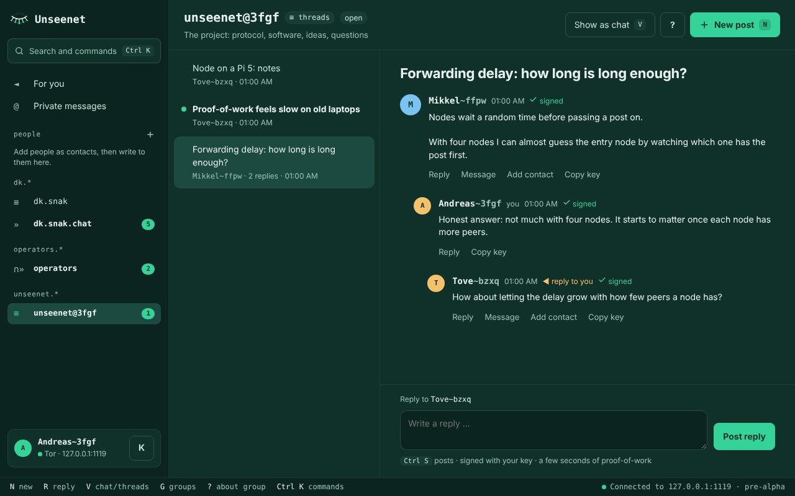
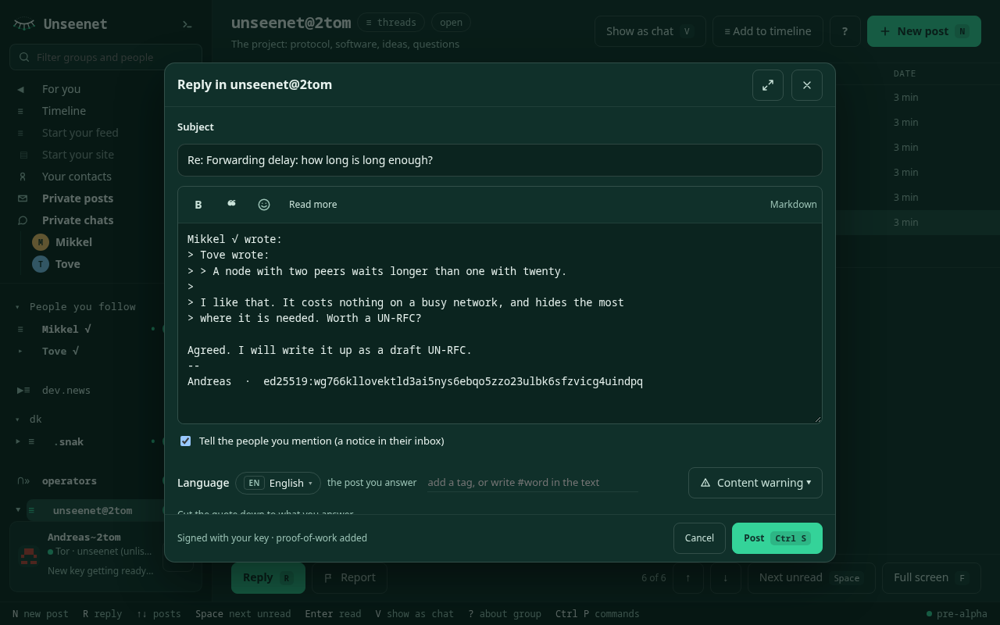
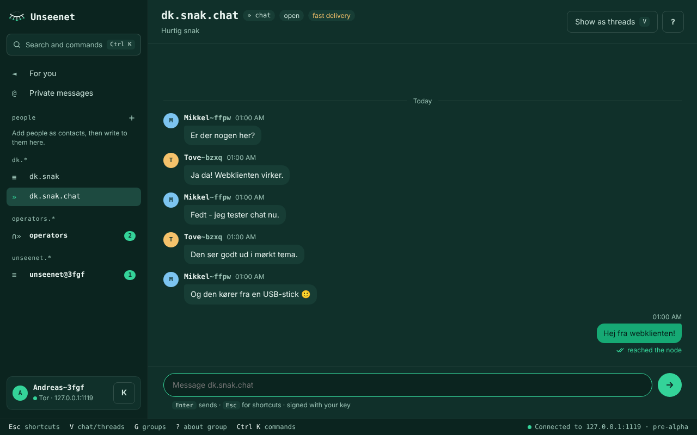
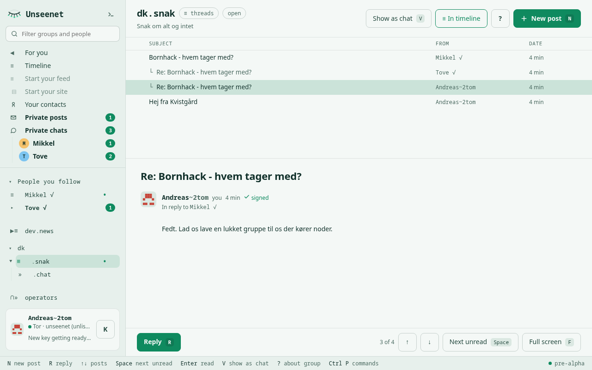

<p align="center">
  <picture>
    <source media="(prefers-color-scheme: dark)" srcset="https://raw.githubusercontent.com/unseenet/unseenet/main/assets/logo-dark.svg">
    
  </picture>
</p>

<h1 align="center">unseenet-gui</h1>

<p align="center"><b>Usenet, unseen - in a window.</b><br>
Discussions you read and answer, chats you chat in, over Tor. Portable on Windows, macOS and Linux, booted from a USB stick - or in any browser, on a phone too, through a web entrance.</p>

<p align="center">
  <a href="https://pypi.org/project/unseenet-gui/"></a>
  <a href="https://github.com/unseenet/unseenet-gui/actions/workflows/tests.yml"></a>
  <a href="LICENSE"></a>
</p>

<p align="center">
  
</p>

> **Pre-alpha.** Nothing is stable yet, and Unseenet has not had a security
> review. Do not rely on it to protect anyone yet.

## What it is

A modern client for [Unseenet](https://unseenet.org), the decentralised,
encrypted discussion network over Tor onion services, built on the
[unseenet](https://github.com/unseenet/unseenet) core with the look of
[unseenet.org](https://unseenet.org).

A discussion is not a chat. Discussion groups work like a newsreader - the
same way as the [terminal client](https://github.com/unseenet/unseenet-tui): the posts as a tree, the selected one
below to read, `↑` `↓` through the thread and `Space` to the next unread, and
`R` to answer in a compose window with the post quoted and your signature
below. Chat groups are chats. The group's owner decides which a group is, and
`V` lets you see it the other way.

| Read a discussion | Answer it, quoting |
|---|---|
|  |  |
| **Chat where it is a chat** | **Light, or dark** |
|  |  |

### Booted from a stick

<p align="center">
  
</p>

The bootable image starts with the Unseenet splash and then the client full
screen - network, Wi-Fi, keyboard and power at the top. The splash is the
image's own; the picture of the client is taken by the image's self-test, which
boots it in QEMU on every build.

### In a browser, on a phone or a computer

The same client runs in an ordinary browser, with nothing to install, through
a **web entrance** ([unseenet-entrance](https://github.com/unseenet/unseenet-entrance),
UN-RFC 0043) - for example the project's own, **https://129.151.209.26/**.
There the client's Python backend - this repository's server code and the
unseenet core - runs in the browser itself (WebAssembly), so the keys stay in
the browser; the entrance only carries the connections to the nodes over Tor.
It can be added to the home screen like an app, keeps the vault on the
device if you want, and updates itself to signed versions. The entrance sees
your IP address (not in Tor Browser), and the page says so at all times: for
the hidden way in, use the portable client or the stick.

On a narrow screen - a phone - the client shows one thing at a time: your
groups, then a group, then a post or the chat. **⋯** holds what does not fit,
and the compose window has its Send button at the top, above the keyboard.

## Get it

The builds are made in [unseenet-portable](https://github.com/unseenet/unseenet-portable)
and [unseenet-bootable](https://github.com/unseenet/unseenet-bootable) (#129),
next to the terminal client's, each night when the core or a client changed:
the newest are their `dev` pre-releases
([portable](https://github.com/unseenet/unseenet-portable/releases/tag/dev),
[bootable](https://github.com/unseenet/unseenet-bootable/releases/tag/dev)).

- **Portable** - unzip and start, from a USB stick or a folder. Tor is included,
  and everything stays in `data/` beside the programs.
  `unseenet-gui-…-usb.zip` has every platform; or take only yours:
  - Windows: `Unseenet Graphical.exe` (an app window through WebView2, no console)
  - macOS: `Start Unseenet Graphical.command` (an app window)
  - Linux: `sh start-graphical-linux.sh` (Chromium, Chrome, Edge or Brave without
    tabs if you have one, else your browser)
- **Bootable** - `unseenet-gui-…-x86_64.img.xz`: write it to a USB stick (for
  example with Raspberry Pi Imager, balenaEtcher or
  `xz -dc FILE | sudo dd of=/dev/sdX bs=4M`), boot from it, and Unseenet starts
  full screen and runs from memory. Set up Wi-Fi and the keyboard on the first
  screen. The same stick also starts the portable client on a running
  computer, with the same `data/`. It needs 4 GB of memory; "safe graphics" in
  the boot menu helps if the screen stays black, and "text only" starts
  the terminal client instead.

Both use the same `Unseenet/` folder and `data/` as the terminal client's portable
build, so the terminal client and this one can share a stick and a vault.

### With Python

You need Python 3.11+.

```sh
pip install unseenet-gui
unseenet-gui                        # opens your browser
unseenet-gui --vault /path/to/unseenet.vault
```

It uses the same vault as the terminal client (`unseenet.vault` in the current folder, or
the portable build's `data/`), so your identity, groups and read marks are the
same in both. Do not run both on the same vault at the same time.

### In its own window

```sh
pip install "unseenet-gui[window]"
unseenet-gui --window
```

This uses [pywebview](https://pywebview.flowrl.com/): the system's web view
(WebView2 on Windows, WebKit on macOS and Linux) in private mode, so nothing
ends up in your browser's history or cache. On Linux it needs the GTK WebKit
libraries.

### Keys

| Key | |
|---|---|
| `Ctrl K` or `Ctrl P` | Commands and groups |
| `N` | New post |
| `R` | Reply: a compose window with the post quoted |
| `↑` `↓` | Previous / next post in the tree |
| `Space` | Next unread post (then the next group with unread posts) |
| `Enter` | Read the post full screen (`Esc` goes back); in a chat: write |
| `M` | Write to someone (paste their key) |
| `V` | Switch between chat and threads |
| `G` | Find groups on your nodes |
| `K` | Show your key |
| `?` | About this group |
| `Ctrl S` | Send, in the compose window |
| `Esc` | Leave the text box, close a dialog |

## How it works

```
 browser window ──HTTP/WebSocket──▶ unseenet-gui ──▶ unseenet core ──Tor──▶ nodes
 (127.0.0.1 only)                   (local server)   vault, keys, postage
```

`unseenet-gui` is a small local server around the core's `Session` - the same
one the terminal client uses. (On the web the same server code runs inside the browser
instead, see above; nothing in this repository is different for it.) It opens the same encrypted vault, starts the same bundled
Tor and talks to the same nodes. The browser only draws what you would see on
screen: **keys, signing, encryption and postage never leave Python**, and the
passphrase is only sent once, to unlock.

The client follows the terminal client's way of working, so you can switch
between them without learning anything new: the same keys, the same icons
(`≡` discussion, `»` chat, `∩` closed), the same compose window.

### Built on the core

Everything but the page is the core's: this client is unseenet's local
client API (UN-RFC 0046, `unseenet.client.localapi`) with its page and a few
routes of its own under `/x/gui/` - the bootable image's network, keyboard and
power, updating, and what the page shows about this machine. The same runtime,
threads, names and safe Markdown tree serve every front end, so this client
shows what the terminal client shows. [CORE-NEEDS.md](CORE-NEEDS.md) records how it got there.

### Security

The local server is reachable from your own computer, so it guards itself.
These are the rules of UN-RFC 0046, kept by the core's local API:

- It listens on **127.0.0.1 only**, on a random port.
- Every start makes a **random token**. It is in the address the client opens
  (`…/#t=…`, in the fragment, so it is never sent in a request line), kept in
  that tab only and removed from the address bar. Every API call and the
  event socket must carry it. Other programs on the computer and web pages in
  your browser do not know it.
- The **Host** header must be our own address, which stops DNS rebinding, and
  an **Origin** header, when sent, must be our own origin.
- A strict **Content-Security-Policy**: the page loads nothing from anywhere
  but the local server - no fonts, images, scripts or styles from outside. A
  post can never make the browser fetch something past Tor.
- Everything people wrote is put on the page as text, never as HTML, and links
  in posts are not clickable: following one would leave Tor.
- Nothing is logged: the server has no access log.

What it does **not** protect against: someone who can read your screen, run
programs as you or read your memory. When you run it in your normal browser,
the window title and address can end up in its history - `--window` avoids
that.

### What it can do yet

It can: unlock or create a vault, choose a name and node, follow and leave
groups, read threads and chats (closed groups decrypted), post, reply, chat,
"For you", private messages (write to anyone by key, conversations as chats,
private replies), contacts, create groups (open, moderated, channel, closed;
threads or chat; fast delivery), invite to your closed groups, your signature,
edit your own posts, names (@you), moderation, roles, bans and member removal, reporting, ignoring people,
a light and a dark theme, the command palette, and phones and other narrow
screens. On the bootable image also: network and Wi-Fi, keyboard layout,
restart and shut down. In a browser: everything above, through a web entrance.

Not yet - use the terminal client: Tor bridges and several identities. **Updating**
a stick or portable folder of this client is not there yet either: its builds
are not signed yet, and unseenet's own updater does not touch them (it would
remove the graphical client). Download the new build from the
[releases](https://github.com/unseenet/unseenet-gui/releases) for now; signed
builds, a notice and an Update button (already in the code, switched off)
are coming (unseenet#264).

## Develop

A playground without Tor:

```sh
git clone https://github.com/unseenet/unseenet-gui && cd unseenet-gui
pip install -e .
tools/dev.sh            # a local node, three people, groups and a closed chat
```

Passphrase `test`. Everything is in `./dev`; `tools/dev.sh clean` deletes it.

```
src/unseenet_gui/
  __main__.py     command line: how to open it, --self-test
  opening.py      app window, browser in app mode, or the browser
  server.py       the core's local API with this page, and /x/gui/
  update.py       updating a stick or portable folder (off for now)
  system.py       the bootable image's network, keyboard and power
  boot.py         the bootable image's session (cage) and its self-test
  splash.py       the boot splash, drawn on the framebuffer
  selftest.py     does this build work?
  static/         the page: index.html, app.css and plain scripts by area (core.js first,
                  start.js ...), loaded in index.html's order - no build step
tests/            the server: the core's guards, the page, /x/gui/
tools/
  dev.sh          a playground without Tor (seed_dev.py fills it)
  record_demo.py  the demo and screenshots in this README, from the playground
```

The front end is plain JavaScript with no dependencies and no build step, so
the client is easy to read and audit.

## Versions and releases

Versions follow [semantic versioning](https://semver.org/) on the same
principles as [unseenet](https://github.com/unseenet/unseenet/blob/main/docs/development.md#versioning):
tags `vX.Y.Z` on `main`, the changes in [CHANGELOG.md](CHANGELOG.md), and
releases on [PyPI](https://pypi.org/p/unseenet-gui) and here; the portable
builds and the image of a release are made in unseenet-portable and
unseenet-bootable. Each release names the minor version of
unseenet it works with (`unseenet[api]>=0.5,<0.6`).

The version numbers are this client's own and do not follow the core's: a
client can gain features, or get fixes, while the core stays where it is, and
that must not have to wait for a core release. So unseenet-gui 0.2.0 may need
unseenet 0.5, and a later 0.2.x or 0.3.0 may need the same core. Which core a
release needs is said in `pyproject.toml` and at the top of its release notes.

To release: move the entries under `## [Unreleased]` in `CHANGELOG.md` to a
new `## [X.Y.Z] - YYYY-MM-DD` section, set `__version__` in
`src/unseenet_gui/__init__.py` and the core release it needs (`unseenet[api]` in
`pyproject.toml`); commit, then
`git tag -a vX.Y.Z -m "unseenet-gui X.Y.Z" && git push origin vX.Y.Z`.
`release.yml` publishes to PyPI and makes the release with the changelog
notes; the portable and bootable builds of the release are made in
unseenet-portable and unseenet-bootable (bump `gui` in their `versions.toml`). Afterwards set `__version__` on main to
the next `.dev0`, so development builds are named after it.

## Part of Unseenet

| Repository | What it is |
|---|---|
| [unseenet](https://github.com/unseenet/unseenet) | The protocol (UN-RFCs), the core library, the node and the command-line client |
| [unseenet-tui](https://github.com/unseenet/unseenet-tui) | The terminal client |
| [unseenet-gui](https://github.com/unseenet/unseenet-gui) | The graphical client - in a window, booted, or in a browser |
| [unseenet-portable](https://github.com/unseenet/unseenet-portable) | Builds the portable clients, Terminal and Graphical, with Tor inside |
| [unseenet-bootable](https://github.com/unseenet/unseenet-bootable) | Builds the bootable images, Terminal and Graphical |
| [unseenet-docs](https://github.com/unseenet/unseenet-docs) | The site [unseenet.org](https://unseenet.org) |
| [unseenet-entrance](https://github.com/unseenet/unseenet-entrance) | Web entrances: the graphical client in an ordinary browser |
| [unseenet-gateway](https://github.com/unseenet/unseenet-gateway) | Gateways to other networks: Usenet, Nostr, Matrix |
| [unseenet-bots](https://github.com/unseenet/unseenet-bots) | Bots that keep channels filled with current content |
| [unseenet-helpbot](https://github.com/unseenet/unseenet-helpbot) | The bot that answers questions in `unseenet.help` |
| [unseenet-watchman](https://github.com/unseenet/unseenet-watchman) | Automatic spam reports and content labels that readers may choose to follow |
| [unseenet-stats](https://github.com/unseenet/unseenet-stats) | Statistics for the network |
| [unseenet-mcp](https://github.com/unseenet/unseenet-mcp) | An MCP server, so a language model can read and post as you (planning) |
| [unseenet-demo](https://github.com/unseenet/unseenet-demo) | Demo people, feeds and sites, made with the command-line client |

## License

[Apache License 2.0](LICENSE). The Unseenet logo: CC BY 4.0.
